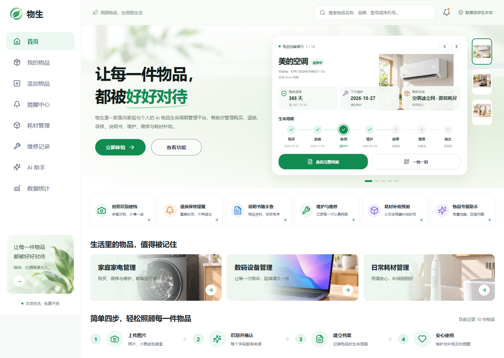
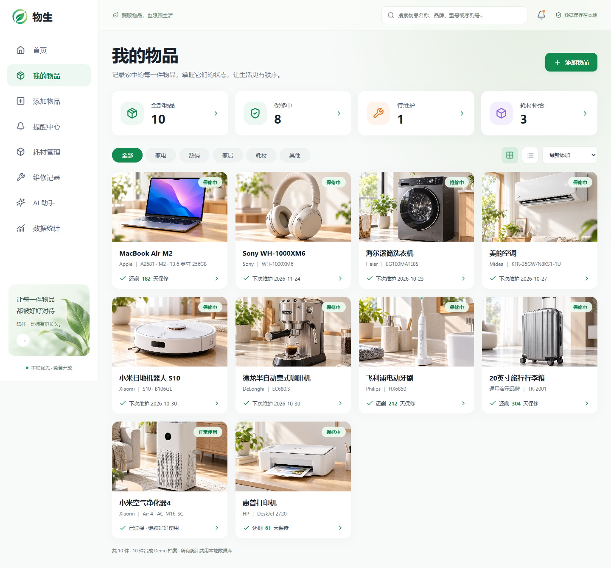
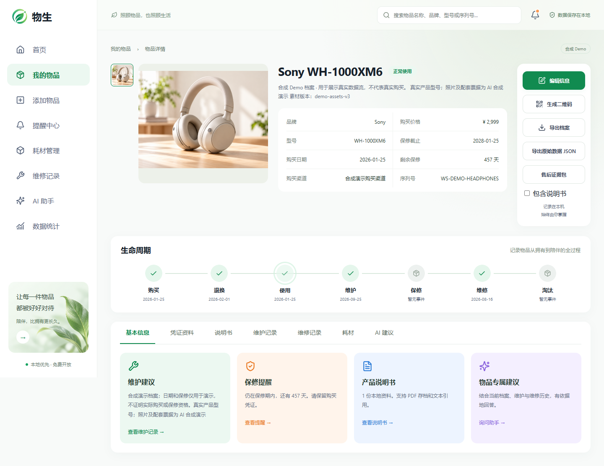
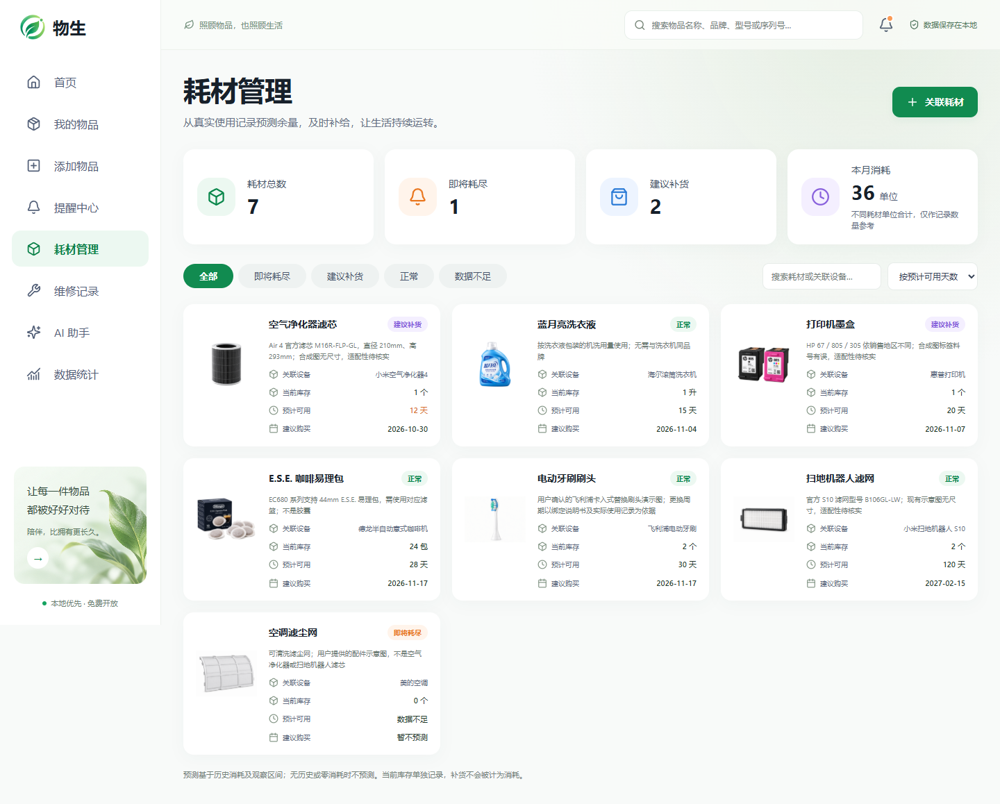
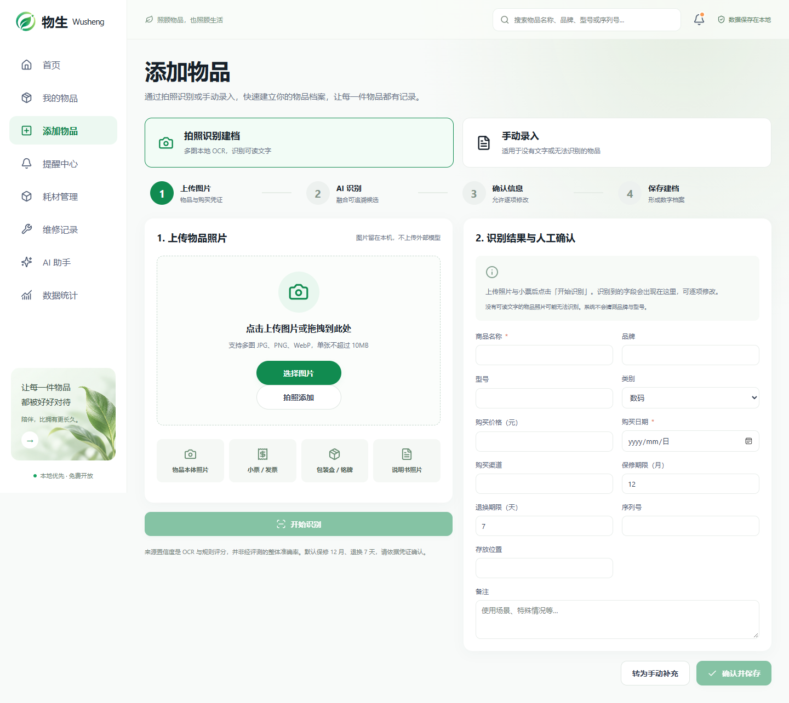
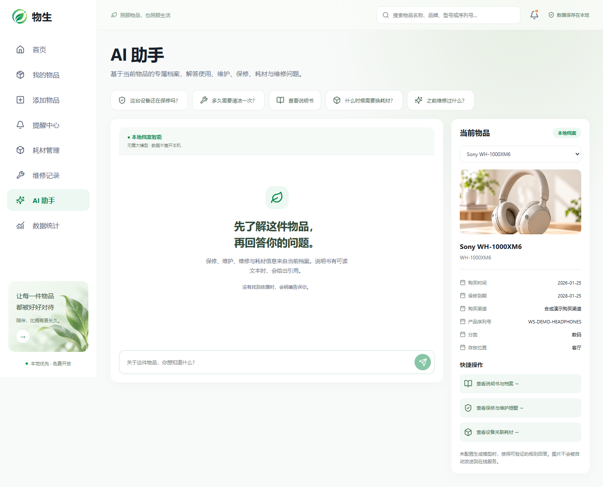

# 物生 Wusheng

[](https://github.com/3331083641-prog/wusheng/actions/workflows/ci.yml)

**AI驱动的家庭物品全生命周期智能管理平台**

物生以一件物品为入口，连接购买凭证、说明书、保修期限、维护维修、关联耗材及历史事件。档案保存在本机，基础管理、OCR和默认资料问答无需云账户、API密钥或大模型。

## 快速开始

Windows 10/11需要Python 3.12、Node.js 22 LTS及npm，首次安装依赖需要联网。

```powershell
git clone https://github.com/3331083641-prog/wusheng.git
Set-Location .\wusheng
.\start-wusheng.cmd
```

也可双击[启动物生.cmd](启动物生.cmd)。入口检查环境、按锁文件安装缺少的依赖、构建前端并打开 <http://127.0.0.1:8000>；按启动窗口的Enter停止本次服务。已有数据库和附件不会重置。新数据库初始化10件合成Demo物品、7种耗材及维修记录，并提供明确标注的合成护理PDF。

手动安装及启动：

```powershell
powershell -ExecutionPolicy Bypass -File .\scripts\setup.ps1
powershell -ExecutionPolicy Bypass -File .\scripts\start.ps1
```

请通过服务访问，直接打开`frontend/index.html`无法连接数据库、路由及API。完整条件、端口、开发模式与安全关闭方法见[运行说明](docs/running.md)。

## 功能

|能力|实际实现|
|---|---|
|多图辅助建档|RapidOCR文字提取、字段候选融合、来源与人工确认；无可读文字可手填|
|物品生命周期|自然月保修和退换期限、维护提醒、维修进度、关联事件与时间线|
|器物与耗材双库|关联物品、库存、实际消耗和补货记录；有足够历史时估算剩余天数|
|说明书与资料|类型化凭证、PDF上传/阅读/下载/删除、文字层提取及主动扫描件OCR|
|物品级问答|ContextBuilder限定物品证据；默认规则回答，可选本地模型生成|
|一物一码|授权字段和文件、有效期、只读局域网档案、撤销与轮换|
|导出与恢复|中文档案PDF、原始JSON、售后资料ZIP；完整备份及校验恢复|
|统计与提醒|同一数据库的统计、ICS日历、主动授权的浏览器通知|
|本地运行|Windows入口、单端口服务、本地数据库和文件；静态资源PWA缓存|

第三方框架、OCR引擎和模型遵守各自许可；对象关联、生命周期协调、证据组织及授权投影属于本项目业务实现。参见[设计边界](docs/design-notes.md)、[开源使用说明](OPEN_SOURCE_USAGE.md)及[第三方清单](THIRD_PARTY.md)。

## 实际界面

|首页|器物库|
|---|---|
|||

|物品详情|耗材管理|
|---|---|
|||

|辅助建档|AI助手|
|---|---|
|||

## 架构与开发

React / TypeScript / Vite → FastAPI / SQLAlchemy → SQLite与本地文件。RapidOCR执行文字识别，pypdf提取PDF文字，pypdfium2渲染扫描页，ReportLab导出档案。当前资料检索使用词项和中文双字匹配。详细对象关系、事务和数据边界见[架构说明](docs/architecture.md)。

```text
frontend/           页面、正式素材、Playwright测试
backend/            数据模型、生命周期、OCR、AI、分享与pytest
scripts/            安装/启动、校验、Benchmark与备份工具
docs/               运行、架构、资料与测试说明
docs/benchmark/     合成OCR、QA原始结果及授权中文数据协议
docs/references/    实际界面及演示素材来源
LICENSES/           第三方依赖和模型许可原文
data/               本机用户数据，不进入Git
```

开发模式运行`powershell -ExecutionPolicy Bypass -File .\scripts\start_dev.ps1`，使用前端5173和后端8000；普通启动仅用8000。开发验证顺序为`/health` → `/generate` → `npm run dev` → 浏览器。API文档位于 <http://127.0.0.1:8000/docs>。

## AI助手与可选模型

默认EvidenceProvider根据所选物品的档案、日期、库存和资料摘录形成规则回答，不调用大模型。OCR候选分数是启发式评分；扫描件OCR须主动触发，最多50页，失败保留原件。回答保留来源及`modelInvoked`标识，证据不足时明确提示。

已安装Ollama及本地模型时，可以在启动前设置：

```powershell
ollama list
$env:WUSHENG_AI_PROVIDER='ollama'
$env:WUSHENG_OLLAMA_URL='http://127.0.0.1:11434'
$env:WUSHENG_OLLAMA_MODEL=Read-Host 'Installed model tag'
.\start-wusheng.cmd
```

不会自动下载模型；当前只允许本机HTTP回环服务，使用文本证据，不启用纯照片视觉识别。守卫、证据不足或模型异常可使请求返回规则答案；来源表示输入证据，不保证生成的每句话均正确。可选模型不影响基础功能独立运行。

## 局域网分享

电脑管理限本机，手机通过随机令牌查看只读档案。电脑需持续运行服务，手机与电脑处于可互通的同一局域网；防火墙、访客隔离及IP变化均会影响访问，程序不自动修改防火墙。

令牌默认7天，可选24小时、30天或长期；有效期不保证停服后可用。价格、位置、记录详情和PDF需明确授权；序列号、票据和发票不进入公开投影。说明书名称、文件、下载与未来新增文件授权分别控制，撤销无法收回已保存副本。当前为HTTP可信局域网方案。基础手机扫码打开已人工确认；手机PDF、隐私及到期/撤销细项未逐项实机验收。详见[操作与排查](docs/sharing.md)及[权限验证](docs/sharing-tests.md)。

## 测试与复现

```powershell
# 使用新隔离目录，避免测试接触个人档案
$env:WUSHENG_DATA_DIR=Join-Path $env:TEMP ('wusheng-tests-'+[guid]::NewGuid())
$env:WUSHENG_AI_PROVIDER='evidence'
.\.venv\Scripts\python.exe -m pytest backend/tests -q
npm --prefix frontend run lint
npm --prefix frontend run build
powershell -ExecutionPolicy Bypass -File .\scripts\test_ui.ps1
.\.venv\Scripts\python.exe scripts/check_docs.py
```

历史合成OCR为3图15字段，精确匹配14/15；58题合成QA中，可回答44题的必要事实命中为规则44/44、本地Qwen43/44，实际模型生成42次。原始结果、失败案例及指标边界见[Benchmark](docs/benchmark/README.md)。这些数字不代表真实家庭用户准确率。授权中文真实样本仍待补充，不把目标规模当成已完成样本。

## 数据、素材与限制

数据默认位于`data/wusheng.db`及图片/PDF子目录。`WUSHENG_DATA_DIR`可更改位置，`.env.example`提供配置说明，应用不自动加载`.env`。完整备份校验路径、SQLite、外键、Schema及文件SHA-256，恢复前保存快照，失败回滚。

Demo图片及购买资料为合成展示，不证明消费、厂商授权或保修资格。新克隆只含合成护理PDF，厂商手册全文不分发；用户可上传自己有权使用的说明书。见[素材来源](docs/demo-assets.md)、[PDF管理](docs/manuals.md)及[本地文件流程](docs/local-files.md)。

- 当前采用单机SQLite，不提供多用户管理、公网部署或应用层加密。
- 耗材估算依赖实际记录，不是训练出的预测模型；稀疏或集中补录会影响结果。
- 纯图像视觉识别、跨设备同步和后台常驻通知未实现。
- LAN HTTP不保证PWA安装；关闭浏览器后请使用ICS/系统日历提醒。
- 模型输出、危险操作和第三方保修条款仍需人工核对。

## 许可与贡献

自主源码及文档采用[MIT](LICENSE)。第三方组件、模型、商标、生成式演示素材和用户文件保留各自权利，不能合并视为MIT。参见[THIRD_PARTY](THIRD_PARTY.md)、[OPEN_SOURCE_USAGE](OPEN_SOURCE_USAGE.md)、[AI_USAGE](AI_USAGE.md)和[贡献指南](CONTRIBUTING.md)。
